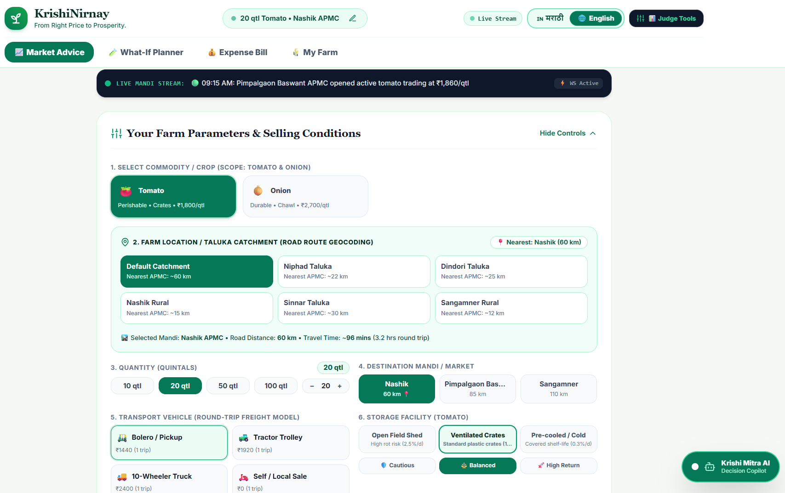
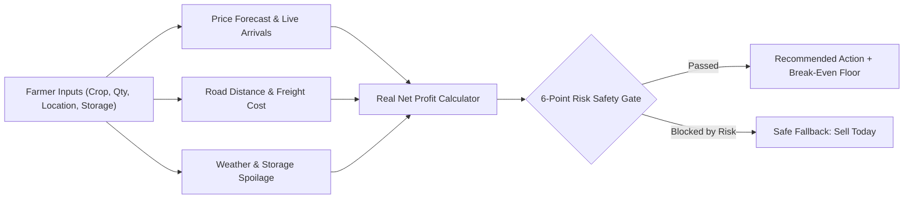
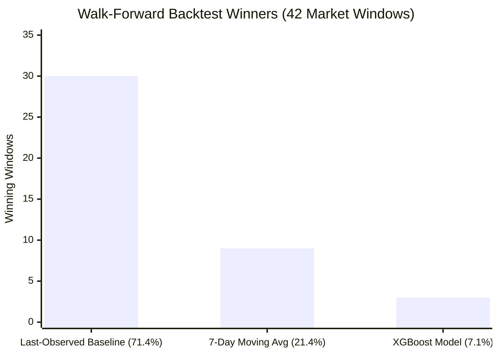
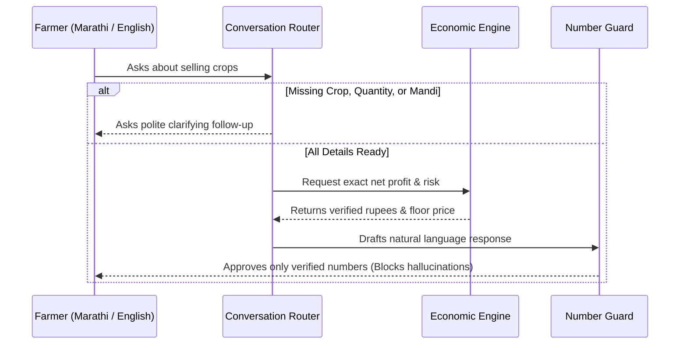
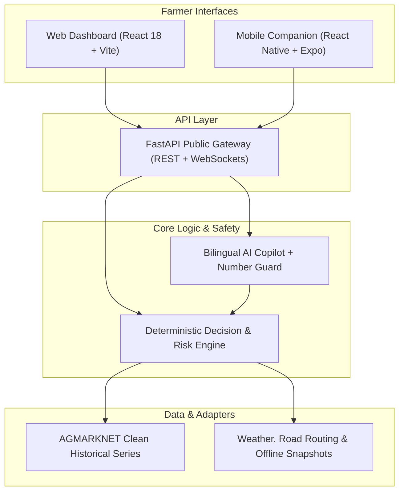

<div align="center">
  <h1>🌾 KrishiNirnay (कृषिनिर्णय)</h1>
  <p><strong>“Sahi Bhav Se, Samriddhi Ki Raah Pe”</strong> — <em>Helping farmers choose the exact day and market to sell for maximum take-home profit.</em></p>
  <p>
    <a href="https://github.com/Parth-Chavan-15/Syrus7_Ode_to_Code"></a>
    <a href="https://fastapi.tiangolo.com"></a>
    <a href="https://react.dev"></a>
    <a href="https://www.python.org"></a>
    
    
  </p>
</div>

<p align="center">
  
  <br />
  <em><strong>Dashboard Preview:</strong> Interactive farmer decision workspace featuring commodity inputs, road-route distance calculation, round-trip vehicle costing, storage selection, live mandi arrivals, and the Krishi Mitra AI Copilot.</em>
</p>

---

## The Problem: Why Farmers Lose Money Every Harvest

Over **86% of Indian farmers are small and marginal**, frequently pushed into **distress selling**—offloading freshly harvested produce immediately at low local prices due to urgent cash needs, storage fears, and fragmented market information.

> *“I have 20 quintals of tomatoes ready in Niphad. Should I sell today at Nashik APMC for ₹1,800/qtl, or wait two days for higher rates?”*

Standard farming apps only display raw daily market rates. However, **a higher sticker price at a mandi does not automatically leave more cash in the farmer's pocket.** Every decision hides real costs:

- **Natural Spoilage:** Perishable crops lose saleable weight every day in storage and during bumpy road transport.
- **Round-Trip Travel Costs:** Diesel expenses, vehicle capacity limits (pickup vs. truck), and empty return journeys quickly erode price spreads.
- **Market Handling Deductions:** Labour (*hamali*) and weighing (*tolai*) fees paid at the mandi.
- **Cost of Waiting:** Delayed cash ties up working capital needed for urgent farm operations or loan payments.

**KrishiNirnay turns uncertain market rates into a clear financial decision—calculating actual take-home earnings after every cost and risk.**

---

## Real Example: How One Decision Earns +₹2,095 More

Consider a farmer with **20 quintals of Tomatoes near Nashik APMC** (today's rate: **₹1,800/qtl**, 60 km transport, ₹12/qtl *hamali/tolai*, and an expected Day-2 price of **₹1,950/qtl**):

| Selling Option | Final Weight Sold | Expenses Deducted | Net Cash in Hand |
| :--- | :--- | :--- | :--- |
| **Sell Today (Baseline)** | 20.0 qtl sold @ ₹1,800/qtl | ₹1,440 transport + ₹240 handling | **₹33,960** |
| **Wait 2 Days (Recommended)** | 19.4 qtl left after shrinkage @ ₹1,950/qtl | Transport + handling + storage + waiting interest | **₹36,055** |

### What the Farmer Receives:
- **Optimal Verdict:** Wait 2 Days at Nashik APMC
- **Extra Take-Home Profit:** **+₹2,095** *(+6.17% above selling today)*
- **Break-Even Safety Floor:** **₹1,842 / qtl** — *“Do not accept below ₹1,842/qtl; if rates drop under this floor, selling immediately is safer.”*
- **Success Confidence:** **62.4%** probability of outperforming today's baseline payout.

---

## What You Can Do in the App

| Workspace Module | Key Capabilities |
| :--- | :--- |
| **📈 Market Advice** | Delivers an instant **Sell Today / Wait / Travel** recommendation alongside a side-by-side net profit comparison across regional mandis (Nashik, Pimpalgaon Baswant, Sangamner) and a 7-day trend. |
| **🧪 What-If Planner** | Interactive stress-testing sliders to simulate sudden shocks—such as a 10% price drop, 20% fuel hike, or double mandi arrivals—before committing to storage or transport. |
| **💰 Expense Bill** | Itemized financial receipt breaking down gross revenue, natural spoilage weight loss, round-trip freight, *hamali*, storage rental, and capital waiting cost. |
| **🌾 My Farm & Language Switch** | One-tap switching between **मराठी (Marathi)** and **English**, Taluka catchment selection, storage options (Open Shed, Ventilated Crates, Cold Storage), and live mandi arrival ticks. |
| **🤖 Krishi Mitra AI Copilot** | Bilingual voice and text assistant that politely asks follow-up questions when crop, quantity, or market details are missing—never guessing blindly. |
| **📊 Judge & Audit Tools** | Built-in verification panel featuring walk-forward forecast backtests, a 3×7 regional price heatmap, and live outage simulation controls. |

---

## How the Decision Engine Works



### 1. Real Net Profit Formula
Crop shrinkage reduces the physical weight sold—it is never double-counted as an extra monetary deduction:

```text
Saleable Weight = Starting Weight × (1 - Daily Storage Loss) × (1 - Transit Loss)

Net Cash Profit = (Saleable Weight × Expected Mandi Price)
                  - Round-Trip Transport Cost
                  - Loading & Mandi Fees (Hamali / Tolai)
                  - Storage Rental Cost
                  - Financing Cost of Waiting
```

### 2. Weather Protection & Six-Point Risk Gate
Live weather inputs (temperature, rainfall, and IMD alerts) scale storage spoilage speed and road travel delays without ever fabricating artificial price bumps. Every recommendation also passes six independent safety checks:
1. **Price Drop Risk** — Downside exposure below the break-even floor.
2. **Arrival Volume Spike** — Incoming supply glut depressing local bids.
3. **Market Volatility** — Sharp day-to-day price swings.
4. **Data Freshness** — Whether APMC trading data is up to date.
5. **Forecast Reliability** — Spread of historical prediction error.
6. **Severe Weather** — Heatwaves or heavy rainfall along the transport route.

### 3. Honest Price Forecasting (Zero AI Hype)
Rather than forcing complex machine learning where simple models perform better, we backtested across **42 chronological out-of-sample market windows** (1 to 7 days ahead):



Because spot agricultural prices show strong short-term persistence, KrishiNirnay uses the winning baseline for live farm decisions while keeping XGBoost metrics open for inspection in the Judge Tools tab.

### 4. Zero-Hallucination AI Copilot & Number Guard
The conversational AI never performs financial calculations on its own. Every number is computed in deterministic Python logic and verified by a built-in **Number Guard** supporting both Arabic (`0–9`) and Marathi/Devanagari (`०–९`) digits:



---

## System Architecture



### Technology Stack

| Layer | Technologies |
| :--- | :--- |
| **Web Frontend** | React 18, TypeScript, Vite, Tailwind CSS, Lucide Icons |
| **Mobile App** | React Native, Expo |
| **Backend Server** | FastAPI, Uvicorn, Pydantic, WebSockets |
| **Data & ML** | Python, Pandas, NumPy, Scikit-learn, XGBoost |
| **AI & Voice** | Gemini Flash, Groq, Whisper Speech-to-Text, Custom Number Guard |

---

## Quick Start Guide

### Prerequisites
- **Python 3.10 or 3.11** (with `pip`)
- **Node.js 18+** (with `npm`)

### Step 1: Clone the Repository
```bash
git clone https://github.com/Parth-Chavan-15/Syrus7_Ode_to_Code.git
cd Syrus7_Ode_to_Code
```

### Step 2: Start the Backend Server
```bash
# Create and activate a virtual environment
python -m venv venv

# On Windows:
venv\Scripts\activate
# On macOS / Linux:
source venv/bin/activate

# Install Python dependencies
pip install fastapi==0.115.0 "starlette<0.39.0" uvicorn pydantic pyyaml pandas numpy scikit-learn xgboost pyarrow requests joblib jsonschema httpx python-multipart pytest

# Launch the backend server
python run_gateway.py
```
The backend API runs at **http://localhost:8000** (interactive docs at **http://localhost:8000/docs**).

### Step 3: Start the Web Dashboard
Open a **second terminal** in the project root:
```bash
cd apps/web
npm install
npm run dev
```
Open your browser and visit **http://localhost:3000**.

> **100% Offline Ready:** External API keys are completely optional. If omitted, KrishiNirnay seamlessly runs using verified historical market series, cached road routes, and deterministic multilingual narration.

*(Optional)* **One-Click Windows Launch:** If dependencies are already installed, run `scripts\start_demo.bat` to start both servers together.

### Verify Installation (Optional)
Run the automated verification suite covering all financial calculations, risk gates, API endpoints, and Number Guard filters:
```bash
python run_tests.py
```
*Expected result: `72 passed`.*

---

## Project Overview

```text
Syrus7_Ode_to_Code/
├── apps/
│   ├── api/          # Backend server, AI chat orchestrator, voice & safety filters
│   ├── web/          # React + TypeScript farmer dashboard
│   └── mobile/       # Expo mobile app
├── configs/          # Cost, transport, risk, and route configurations
├── contracts/        # Shared data schemas between backend and frontend
├── data/             # Verified Maharashtra Tomato & Onion market datasets
├── docs/             # Dashboard screenshots and audit documentation
├── reports/          # Walk-forward model comparison metrics
├── scripts/          # One-click launch & evaluation scripts
├── services/         # Core economic, risk, weather, and forecasting engine
├── tests/            # 72 automated tests verifying accuracy and edge cases
├── run_gateway.py    # Backend launcher
└── run_tests.py      # Automated test runner
```

---

## Team & Competition

- **Project:** KrishiNirnay (कृषिनिर्णय)
- **Competition:** Syrus 7.0 (Ode-to-Code 2026) — Agriculture PS_02
- **Repository:** [Parth-Chavan-15/Syrus7_Ode_to_Code](https://github.com/Parth-Chavan-15/Syrus7_Ode_to_Code)

*Built to bring transparent math and fair earnings to Indian agriculture.*
